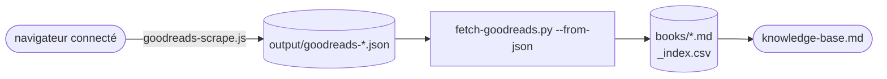

# Goodreads — Livres lus

Livres marqués "read" sur le profil Goodreads `124105866`.

Goodreads a coupé les flux RSS (`list_rss` → 404, constaté le 2026-11-01) et l'étagère
n'est plus lisible sans session. L'import passe donc par le navigateur connecté, et
Goodreads est **retiré du refresh mensuel CI** (`fetch-all.yml`) :

1. Ouvrir https://www.goodreads.com (session Adrien) et exécuter `scripts/goodreads-scrape.js`
   dans la console (ou via Claude in Chrome)
2. Attendre `window.__grStatus === 'done'`, puis enregistrer `JSON.stringify(window.__books)`
   dans `output/goodreads-124105866.json` (gitignoré)
3. `task fetch-goodreads` — réécrit `books/*.md` + `_index.csv` (tags et reviews manuelles préservés)

Sans export JSON (ou si le RSS revient vide), le script ne touche pas aux données existantes.

